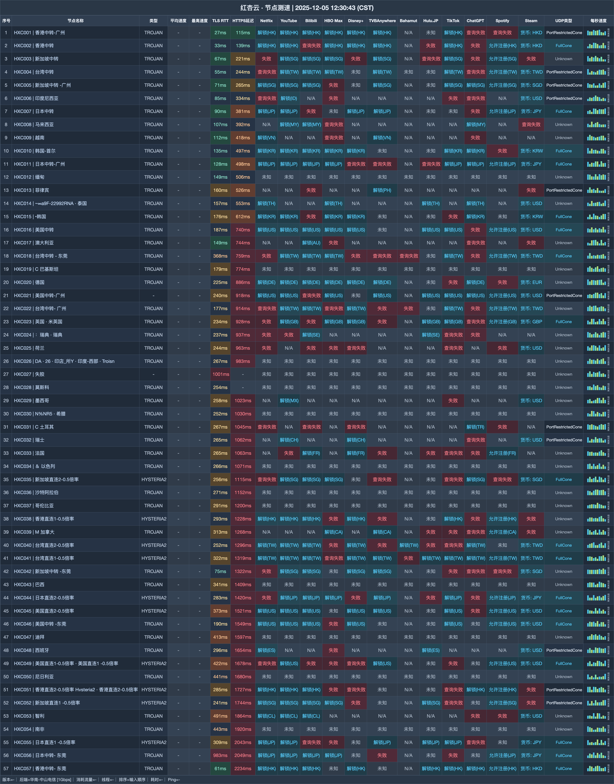

# 红杏云机场测评｜200G 月档 20 元，家庭共享不限设备（2026-11-02 更新）

> **先看结论：四档家庭月付覆盖 200G 到 1200G，还有两档用完为止的大流量包。**
>
> 👉 **[进入注册页](https://hongxingdl.one/web/#/login?code=jxeAiWEC)** · 一般家庭从 20 元 200G 开始，持续重度使用再看 60 元 800G。

## 哪些人更匹配

- 家庭成员与多台终端同时使用的人
- 每月需要 200G—1200G 流量的人
- 希望另备 3000G 不限时流量包的人

## 哪些情况建议跳过

- 必须先看到下载吞吐数据才购买的人
- 要求套餐支持退款的人

| 快速判断 | 当前信息 |
|---|---|
| 月付起点 | 200G / 20 元 |
| 月流量跨度 | 200G—1200G |
| 档位限速 | 300—1000Mbps |
| 设备规则 | 月档与 3000G 档不限；6000G 档 20 台 |
| 线路类型 | IEPL |
| 月档附加 | 赠送 EMBY |

**站点定位**：红杏云（Hongxing）提供 IEPL 家庭方案，20 元 200G 起；月付四档支持家庭共享与不限设备。

## 全部套餐怎么排

| 套餐 | 价格 | 流量 | 设备 | 限速 | 说明 |
|---|---:|---:|---:|---:|---|
| 轻量-包月200G | ¥20/月付 | 200G · 每月 | 不限 | 300M | 可购买重置包；家庭共享；赠送EMBY |
| 冲浪-包月500G | ¥40/月付 | 500G · 每月 | 不限 | 500M | 可购买重置包；家庭共享；赠送EMBY |
| 豪华-包月800G | ¥60/月付 | 800G · 每月 | 不限 | 800M | 可购买重置包；家庭共享；赠送EMBY |
| 大师-包月1200G | ¥80/月付 | 1200G · 每月 | 不限 | 1000M | 可购买重置包；家庭共享；赠送EMBY |
| 高级-不限时3000G | ¥388/一次性 | 3000G · 用完为止 | 不限 | 1000M | 可购买重置包；家庭共享 |
| 豪华-不限时6000G | ¥688/一次性 | 6000G · 用完为止 | 20 | 1000M | 可购买重置包 |

**购买前提醒：**测速样本只有延迟与解锁信息：香港中转样本的 TLS RTT 为 27ms、HTTPS 为 115ms，没有下载速度。套餐不退款；6000G 档写 20 台设备，但家庭共享范围没有展开。

## 节点测速图

这张表包含 57 行延迟与解锁记录，测试环境为 华南-中山电信 [1Gbps]，不含下载吞吐。 图中日期为 **2025-12-05**，完整表格如下：

## 选择顺序

1. 先以 20 元 200G / 300Mbps 观察家庭月用量。
2. 稳定超过 500G 时，再比较 60 元 800G / 800Mbps 档。
3. 不想每月续费可看 388 元 3000G；6000G 档先确认 20 台设备的使用边界。

## 注册入口

👉 **[打开注册页面](https://hongxingdl.one/web/#/login?code=jxeAiWEC)** · 一般家庭从 20 元 200G 开始，持续重度使用再看 60 元 800G。

*本文含推广链接；通过该入口注册或购买，本站可能获得佣金。*

## 本文更新

- **2026-10-31**：重新编排购买建议与全部套餐，共保留 5 个套餐/展示项。
- **2025-12-05**：节点测速图所示日期。

---
*套餐价格、节点与活动可能调整，付款前请以购买页当时显示为准。*

展开相关搜索词

搜索组合：红杏云、hongxing、红杏机场、红杏云机场、机场测评2026、IEPL机场、家庭机场、代理订阅、红杏云入口、红杏云注册、红杏云测速

